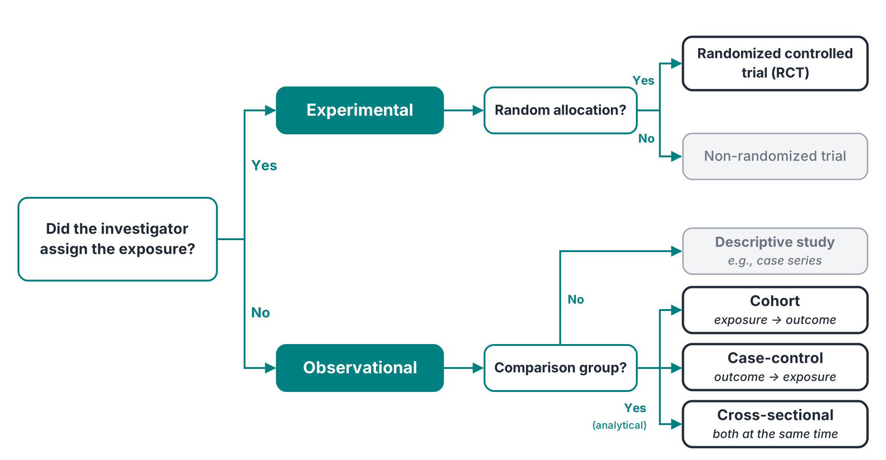
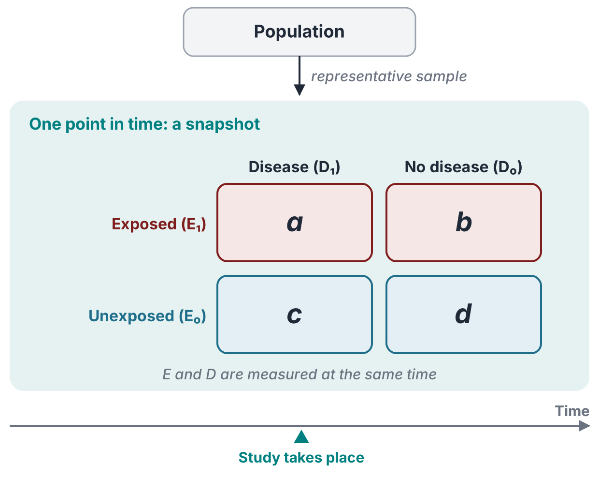
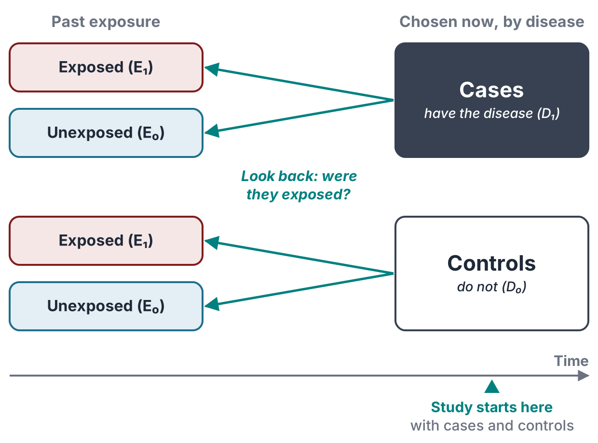
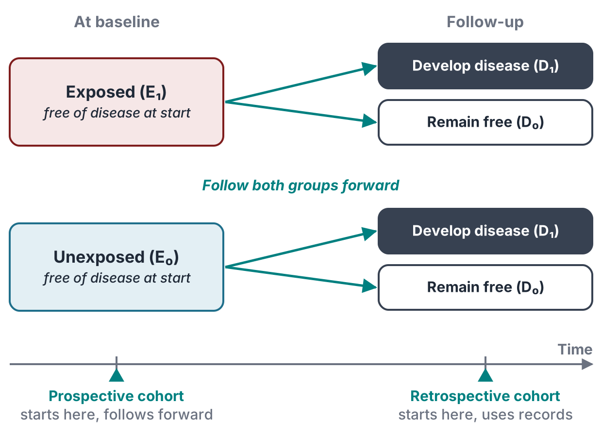
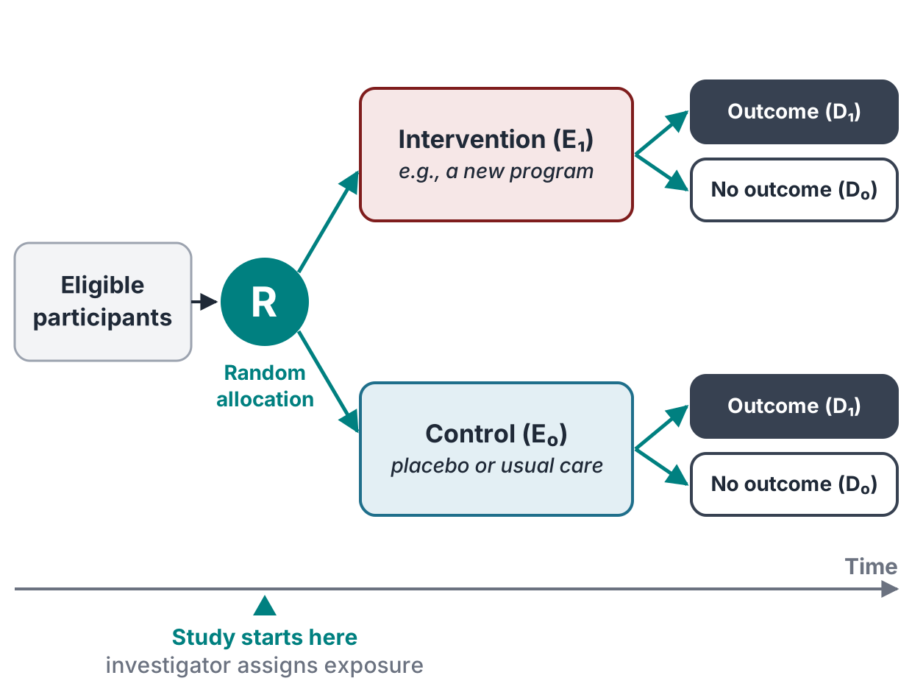
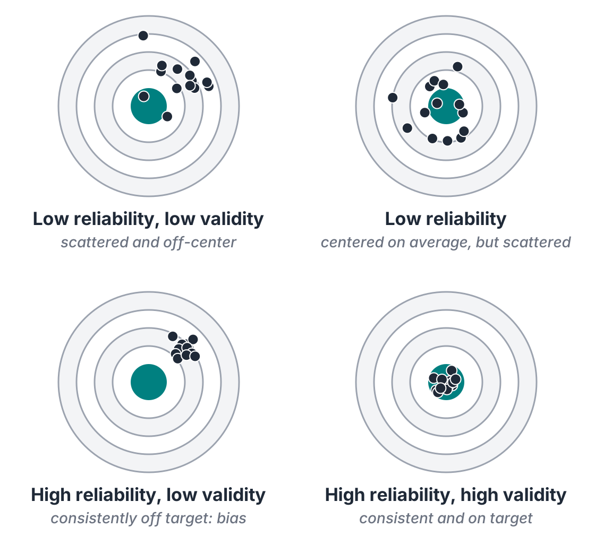
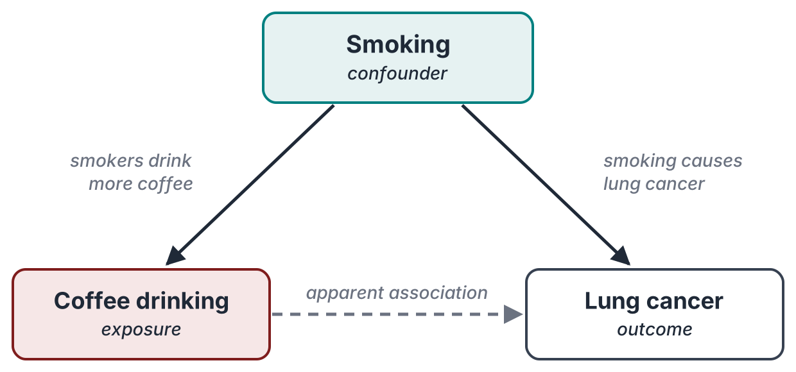

## Today

By the end of this class, you should be able to:

1.  **Classify** a study by how participants are selected and how time is handled
2.  **Compute and interpret** a relative risk (RR) and an odds ratio (OR)
3.  **Distinguish** random error, bias, confounding, and effect modification
4.  **Explain** what qualitative methods and research ethics add to a study design

::: takeaway
Every design answers the same question: **is an exposure associated with a health outcome?** They differ in where the investigator starts.
:::

------------------------------------------------------------------------

## The E--D framework

:::: columns
::: {.column width="52%"}
-   **Exposure ($E$):** a risk factor (smoking, air pollution) or an intervention (a vaccine, a program)
-   **Disease ($D$):** any health outcome --- illness, injury, death
-   $E_1$ / $E_0$ = exposed / unexposed
-   $D_1$ / $D_0$ = with / without the outcome
:::

::: {.column width="48%"}
|                    | $D_1$ (disease) | $D_0$ (no disease) |
|--------------------|:---------------:|:------------------:|
| **$E_1$ (exposed)**   |      $a$      |        $b$         |
| **$E_0$ (unexposed)** |      $c$      |        $d$         |

This 2×2 table returns in every design.
:::
::::

::: notes
The designs differ in which margin the investigator fixes first: the rows (exposure, cohort and RCT), the columns (disease, case-control), or neither (cross-sectional).
:::

------------------------------------------------------------------------

## Classifying study designs

{fig-align="center" width="92%"}

::: notes
Walk the tree with one question: does air pollution cause asthma? Can we assign pollution? No --- observational. Do we have a comparison group? Yes --- analytical. Then: start from exposure (cohort), from disease (case-control), or measure both at once (cross-sectional). Greyed boxes exist but are not covered today.
:::

------------------------------------------------------------------------

## Cross-sectional studies

:::: columns
::: {.column width="45%"}
-   Exposure and outcome measured **at the same time**
-   Also called **prevalence studies**
-   Quick and relatively inexpensive (e.g., national health surveys)

**Limitations**

-   Cannot tell whether $E$ came before $D$
-   Captures existing cases, which over-represents long-lasting disease
-   Too few cases of rare diseases
:::

::: {.column width="55%"}
{width="100%"}
:::
::::

::: notes
Example: NHANES or BRFSS. The temporality problem is the key point --- does depression lead to poor sleep, or poor sleep to depression? A snapshot cannot say.
:::

------------------------------------------------------------------------

## Case-control studies

:::: columns
::: {.column width="45%"}
-   Select **cases** ($D_1$) and comparable **controls** ($D_0$), then look **back** at exposure
-   Efficient for **rare diseases** and long latency

**Limitations**

-   Exposure recalled after diagnosis → **recall bias**
-   Comparable controls are hard to find
-   No incidence, so no RR → **odds ratio**
:::

::: {.column width="55%"}
{width="100%"}
:::
::::

::: notes
Classic example: Doll and Hill (1950), lung cancer patients vs. other hospital patients, asked about smoking history. Controls should come from the same population that produced the cases.
:::

------------------------------------------------------------------------

## Cohort studies

:::: columns
::: {.column width="45%"}
-   Start from **exposure status**; everyone free of the disease at baseline
-   Follow both groups **forward** and count new cases
-   **Prospective:** starts now, follows into the future
-   **Retrospective:** uses existing records

**Strengths:** incidence and RR directly; several outcomes; rare exposures

**Limitations:** slow and costly; loss to follow-up; inefficient for rare diseases
:::

::: {.column width="55%"}
{width="100%"}
:::
::::

::: notes
Example: the Framingham Heart Study (since 1948). Prospective and retrospective cohorts share the same logic --- exposure first, outcome later --- and differ only in when the investigator arrives. Long follow-up also means diagnostic criteria may change along the way.
:::

------------------------------------------------------------------------

## Randomized controlled trials (RCTs)

:::: columns
::: {.column width="45%"}
-   The investigator **assigns** the exposure at random
-   Randomization balances confounders, **known and unknown**
-   **Blinding** limits information bias
-   Individuals or groups (schools, villages) can be randomized
-   Strongest design for causal inference, but not always ethical or feasible
:::

::: {.column width="55%"}
{width="100%"}
:::
::::

[Drug trials run in phases: **I** safety and dose · **II** efficacy and side effects · **III** large RCT against standard care · **IV** post-marketing surveillance]{.source}

::: notes
Why not always an RCT? We cannot randomize people to smoke. Optional story: observational studies suggested hormone replacement therapy protected women against heart disease; the Women's Health Initiative trial (2002) found the opposite for estrogen plus progestin. Women who chose HRT were healthier to begin with --- confounding that randomization removed.
:::

------------------------------------------------------------------------

## Designs at a glance

| Design | Investigator | Selected on | Direction | Timing |
|----------------|----------------|----------------|----------------|----------------|
| **Cross-sectional** | Observes | Neither (representative sample) | None: $E$ and $D$ together | One point in time |
| **Case-control** | Observes | Disease | Backward ($D \to E$) | Usually retrospective |
| **Retrospective cohort** | Observes | Exposure | Forward ($E \to D$) | Retrospective |
| **Prospective cohort** | Observes | Exposure | Forward ($E \to D$) | Prospective |
| **RCT** | **Intervenes** | Exposure, assigned at random | Forward ($E \to D$) | Prospective |

::: takeaway
No design is best in general. The right one depends on the question, the disease, and the time and money available.
:::

------------------------------------------------------------------------

## Which design is it?

::: ask
1.  Past pesticide exposure is compared between 150 children with leukemia and 300 children without. [→ case-control]{.fragment .answer}
2.  5,000 adults complete one survey on their sleep and their mood. [→ cross-sectional]{.fragment .answer}
3.  Smoking is recorded for 10,000 nurses, who are then followed for 20 years for heart disease. [→ prospective cohort]{.fragment .answer}
4.  Schools are randomly assigned to a new physical-activity program or to the usual curriculum. [→ RCT (cluster)]{.fragment .answer}
:::

::: notes
Give 30 seconds per item; ask for a show of hands before revealing. For item 1, ask why a cohort would be impractical (childhood leukemia is rare).
:::

------------------------------------------------------------------------

## Measuring association: RR and OR

:::: columns
::: {.column width="45%"}
|           | $D_1$ | $D_0$ |  Total  |
|-----------|:-----:|:-----:|:-------:|
| **$E_1$** |  $a$  |  $b$  | $a + b$ |
| **$E_0$** |  $c$  |  $d$  | $c + d$ |

::: takeaway
**Reading RR or OR**\
= 1: no association\
\> 1: exposure linked to higher risk\
\< 1: exposure linked to lower risk
:::
:::

::: {.column width="55%"}
**Relative risk** --- cohort studies and RCTs

$$RR = \frac{a/(a+b)}{c/(c+d)}$$

**Odds ratio** --- case-control studies

$$OR = \frac{a \times d}{b \times c}$$

The investigator fixes the numbers of cases and controls, so risk cannot be computed; the OR stands in for the RR.
:::
::::

------------------------------------------------------------------------

## Worked example: one table, two measures

:::: columns
::: {.column width="50%"}
**Rare outcome** (3% vs. 1%)

|           | $D_1$ | $D_0$ | Total |
|-----------|:-----:|:-----:|:-----:|
| **$E_1$** |  30   |  970  | 1,000 |
| **$E_0$** |  10   |  990  | 1,000 |

::: fragment
$RR = \dfrac{30/1000}{10/1000} = 3.0$

$OR = \dfrac{30 \times 990}{970 \times 10} \approx 3.1$
:::
:::

::: {.column width="50%"}
**Common outcome** (40% vs. 20%)

|           | $D_1$ | $D_0$ | Total |
|-----------|:-----:|:-----:|:-----:|
| **$E_1$** |  400  |  600  | 1,000 |
| **$E_0$** |  200  |  800  | 1,000 |

::: fragment
$RR = \dfrac{400/1000}{200/1000} = 2.0$

$OR = \dfrac{400 \times 800}{600 \times 200} \approx 2.7$
:::
:::
::::

::: {.fragment .takeaway}
When the outcome is rare, OR ≈ RR. When it is common, the OR exaggerates the association.
:::

::: notes
Have students compute both measures for the left table before revealing. Then ask them to predict whether the gap will be larger or smaller on the right.
:::

------------------------------------------------------------------------

## Error, reliability, and validity

:::: columns
::: {.column width="52%"}
**Random error** --- chance variation

-   Scatters results → lowers **reliability**
-   Shrinks as the sample grows

**Systematic error (bias)** --- a consistent shift

-   Pushes results off target → lowers **validity**
-   Does *not* shrink with sample size
:::

::: {.column width="48%"}
{width="100%"}
:::
::::

::: takeaway
**Study validity:** *internal* --- correct for the people studied; *external* --- generalizes to other populations.
:::

::: notes
Reliability can be checked as test--retest (same test, different times) and inter- or intra-observer agreement. Types of measurement validity (face, content, construct, criterion) are in the chapter for reference; not examined.
:::

------------------------------------------------------------------------

## Bias: two main families

Bias is systematic error introduced by **who ends up in the study** or **how information is collected**.

::: panel-tabset
### Selection bias

-   **Healthy worker effect:** workers are healthier than the general population
-   **Volunteer bias:** volunteers differ from non-volunteers
-   **Berkson's bias:** hospital-based samples distort associations
-   **Loss to follow-up:** those who drop out differ from those who stay

### Information bias

-   **Recall bias:** cases remember past exposures differently from controls
-   **Interviewer bias:** knowing who is a case changes how questions are asked
-   **Social desirability bias:** under-reporting of stigmatized behaviors
-   **Misclassification:** imperfect tests or records place people in the wrong group
:::

------------------------------------------------------------------------

## Confounding

:::: columns
::: {.column width="52%"}
{width="100%"}

A confounder is (1) associated with the exposure, (2) a cause of the outcome, and (3) not a step on the path between them.
:::

::: {.column width="48%"}
**At the design stage**

-   **Randomization** --- balances all confounders
-   **Restriction** --- study non-smokers only
-   **Matching** --- pair participants on smoking

**At the analysis stage**

-   **Stratification** --- analyze smokers and non-smokers separately
-   **Regression** --- adjust for several at once
:::
::::

::: notes
Ask first: coffee drinkers have more lung cancer --- does coffee cause lung cancer? Let students propose the third variable before showing the diagram.
:::

------------------------------------------------------------------------

## Effect modification

-   The effect of an exposure **depends on the level of a third variable**
-   Unlike confounding, it is not a bias to remove --- it is a finding to report

**Lung cancer deaths per 100,000 person-years**

|                 |     Non-smoker     |       Smoker       |
|-----------------|:------------------:|:------------------:|
| **No asbestos** | 11 &nbsp;(RR = 1)  | 123 &nbsp;(RR ≈ 11) |
| **Asbestos**    | 58 &nbsp;(RR ≈ 5)  | 602 &nbsp;(RR ≈ 53) |

::: takeaway
If the two effects simply added up, we would expect RR ≈ 15. The observed RR ≈ 53: the exposures act in **synergy**.
:::

[Insulation workers vs. a comparison group of men; Hammond, Selikoff & Seidman (1979)]{.source}

::: notes
Additive expectation: RR(A) + RR(S) − 1 = 5 + 11 − 1 = 15. Multiplicative expectation: 5 × 11 = 55, close to the observed 53. Keep the formulas off the slide; the point is that the joint effect is far larger than either alone. The opposite pattern is called antagonism.
:::

------------------------------------------------------------------------

## Qualitative and mixed methods

:::: columns
::: {.column width="50%"}
Explore perceptions, beliefs, and lived experience --- the *why* and *how* behind the numbers.

-   **Interviews:** structured, semi-structured, or in-depth
-   **Focus groups:** guided discussion in small groups
-   **Participant observation:** researcher immersed in the setting
-   **Document analysis:** policies, records, media
:::

::: {.column width="50%"}
**Combining with quantitative methods**

1.  *Before:* develop hypotheses and survey questions
2.  *During:* explain unexpected results
3.  *After:* interpret and validate findings

::: highlight-box
**Example:** a regional health needs assessment pairs disease rates and service data with resident focus groups and interviews with community leaders.
:::
:::
::::

------------------------------------------------------------------------

## Ethics in population health research

:::: columns
::: {.column width="50%"}
**Four principles**

1.  **Autonomy** --- respect people's right to decide
2.  **Beneficence** --- maximize benefits
3.  **Non-maleficence** --- do no harm
4.  **Justice** --- share burdens and benefits fairly
:::

::: {.column width="50%"}
**In practice**

-   Informed consent
-   Confidentiality and data security
-   Extra protection for vulnerable groups
-   Review by an Institutional Review Board (IRB)
-   Transparent, honest reporting
:::
::::

::: notes
Why these rules exist: the US Public Health Service syphilis study at Tuskegee (1932--1972) withheld treatment from Black men for decades. It led to the National Research Act (1974), which formalized IRBs, and the Belmont Report (1979).
:::

------------------------------------------------------------------------

## Key takeaways

1.  **Where the investigator starts** --- exposure, disease, or neither --- defines the design
2.  Cohorts and RCTs give the **RR**; case-control studies give the **OR**, which approximates the RR for rare outcomes
3.  Random error shrinks with sample size; **bias does not**
4.  Control confounding by **design** (randomization, restriction, matching) or by **analysis** (stratification, regression)
5.  Qualitative methods add context; **ethics** apply at every step

::: takeaway
One sentence for the exam: **the research question chooses the design, and every design must be checked for bias, confounding, and ethics.**
:::

# Questions?
